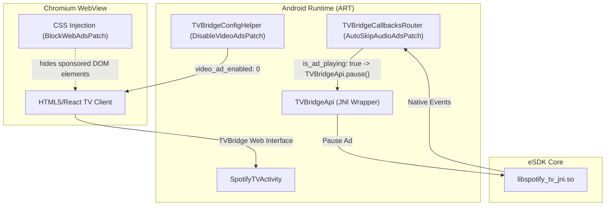

# Spotify Android TV Morphe patches

Spotify Android TV customizations for use with [Morphe](https://morphe.software/).
This repository publishes patch source and bundles, not Spotify APKs.

<!-- prettier-ignore -->
> [!NOTE]
> These patches target Spotify Android TV 1.134.2 (`com.spotify.tv.android`). Other versions are
> not supported.

[**➕ Add to Morphe**](https://morphe.software/add-source?github=s1ddhants1/morphe-patches/tree/main)

Open this link on Android or Android TV with Morphe Manager installed to add the stable source. Releases are published from `main`.

## Patches

All Android TV ad-blocking patches are enabled by default.

| Patch | Default | Behavior |
| --- | --- | --- |
| Disable video ads (Android TV) | Enabled | Disables video advertisements by forcing `video_ad_enabled: 0` in the Android TV embedded bridge config (`TVBridgeConfigHelper`). Completely prevents video ad prerolls and midrolls. |
| Auto-skip audio ads (Android TV) | Enabled | Hooks playback event router in `TVBridgeCallbacksRouter`. When an ad segment (`is_ad_playing: true`) is detected, it automatically pauses playback and resets the ad state to suppress audio ads. |
| Block web banners & promo UI (Android TV) | Enabled | Injects custom CSS rules into `SpotifyTVActivity`'s Chromium WebView upon page load to suppress sponsored tiles, upgrade banners, and promotional UI carousels. |

<!-- PATCHES_START EXPANDED -->
> **[v1.0.0](https://github.com/s1ddhants1/morphe-patches/releases/tag/v1.0.0)**&nbsp;&nbsp;•&nbsp;&nbsp;`main`&nbsp;&nbsp;•&nbsp;&nbsp;6 patches total
<details open>
<summary>📦 Spotify (Android TV)&nbsp;&nbsp;•&nbsp;&nbsp;6 patches</summary>
<br>

**🎯 Supported versions:**

| 1.134.2 |
| :---: |

| 💊&nbsp;Patch | 📜&nbsp;Description | ⚙️&nbsp;Options |
|----------|----------------|-----------|
| [Allow non-TV devices](#allow-non-tv-devices) | Enables Spotify Android TV to run on phones, tablets, and emulators by bypassing the TV UI mode check. |  |
| [Auto-skip audio ads (Android TV)](#auto-skip-audio-ads-android-tv) | Automatically skips commercial audio intervals when detected by TVBridge. |  |
| [Block web banners & promo UI (Android TV)](#block-web-banners-promo-ui-android-tv) | Injects adblock styles, product state override (premium), and queue-level ad stream removal into the WebView. |  |
| [Debuggable build](#debuggable-build) | Marks the app debuggable: enables run-as access to app files and WebView remote inspection. |  |
| [Disable video ads (Android TV)](#disable-video-ads-android-tv) | Disables video advertisements in the Android TV embedded bridge config. |  |
| [Hide upgrade button](#hide-upgrade-button) | Hides the Upgrade button in the navigation bar. |  |

</details>

<!-- PATCHES_END -->

## Install

Releases are listed on the [releases page](https://github.com/s1ddhants1/morphe-patches/releases).

A patched APK uses a different signing certificate from stock Spotify. Installing it with
the same package name requires removing stock Spotify first, which removes
its local app data. Keep Manager's signing key for future updates.

### Using Morphe Manager (Android TV)

Use the **Add to Morphe** link above, then confirm the source in Manager:

1. Open **Sources**, select **Add**, and choose **Remote**.
2. Paste the source URL:
   ```text
   https://raw.githubusercontent.com/s1ddhants1/morphe-patches/refs/heads/main/patches-bundle.json
   ```
3. Expand **Spotify Android TV Morphe patches** and enable **Experimental app versions**.
4. Return to the app list and select **Spotify (Android TV)** (`1.134.2`).
5. Choose **No, I already have an APK**, and select your target APK (`com.spotify.tv.android`).
6. Select **Proceed to patching**.
7. Wait for **Patching complete**, then select **Install**.
8. Launch Spotify from the Android TV launcher.

Keep your own stock APK for patching; the repository does not distribute Spotify.

### Using Morphe CLI / Morphe Desktop

You can also patch APKs directly using the [Morphe CLI](https://github.com/MorpheApp/morphe-cli) or [Morphe Desktop](https://github.com/MorpheApp/morphe-desktop):

```bash
morphe patch \
  --bundle path/to/patches-bundle.json \
  --in path/to/com.spotify.tv.android_1.134.2.apk \
  --out path/to/spotify-tv-patched.apk \
  --experimental
```

## Architecture & System Flow

Spotify Android TV is a hybrid application running a Chromium WebView interface communicating with an embedded native client via JNI:



## Return to stock Spotify

Uninstall the patched Spotify TV app, then reinstall the official version from the Google Play Store on your TV and sign in again. Stock Spotify uses a different signing certificate, so it cannot replace a Manager-signed installation through an update.

## Try a local build

Build the bundle using the Gradle wrapper:

```bash
cd morphe-patches
./gradlew build
```

The compiled patch bundle will be generated in:
```text
patches/build/libs/patches-1.0.0.mpp
```

## License

The patch code is licensed under [GPL-3.0](LICENSE). This project is independent of Spotify and the Morphe project.
